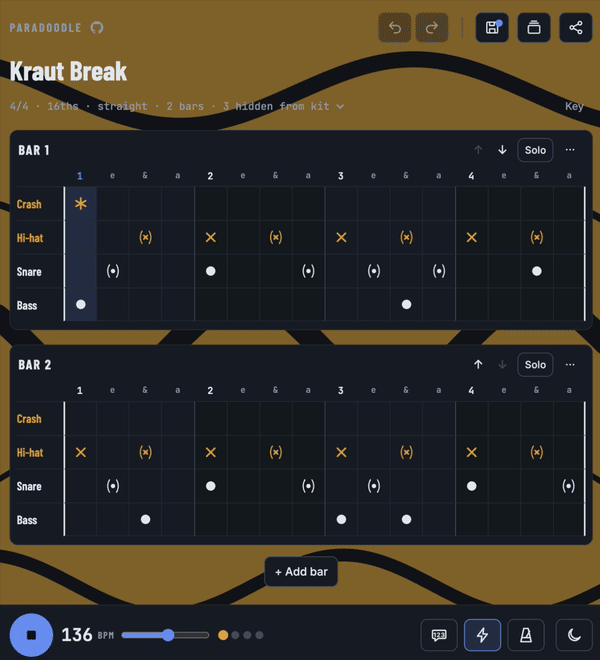

#  Paradoodle

**Ever wanted to quickly doodle a groove, or try one out before you practise it?**

Paradoodle lets you doodle your grooves. Maybe one pops into your head on the bus, in the rehearsal room or halfway through a song; get it down before it's gone. Tap the beat into a grid, play it back to check it feels right, practise along with a click or a spoken count, and when it's ready, export a proper drum sheet with staff notation for the next session.

**Try it now: [dr-duplo.github.io/paradoodle](https://dr-duplo.github.io/paradoodle/)**. It runs in any modern browser, is made for phones and can be installed like an app.

<p align="center">
  <a href="https://dr-duplo.github.io/paradoodle/"></a>
</p>

## Features

- Quickly doodle your groove on a tap-to-draw drum grid
- Save, import and export your grooves
- Share a groove as a link or a QR code, and paste a link anywhere in the app to open one
- Practise along with a click, a visual flash or a spoken count
- Export a drum sheet with staff notation as a PDF or PNG, with a QR code to open the groove again

## Why "Paradoodle"

A _paradiddle_ is one of the first rudiments every drummer learns: right, left, right, right, left, right, left, left. A _doodle_ is what you scribble in the margin when an idea won't leave you alone. Paradoodle is the two put together: drum ideas, sketched quickly and a little messily, the way they arrive.

## In detail

**Sketch.** The grid has rows for crash, ride, hi-hat, snare, toms, bass drum and hi-hat foot. Tap a cell to cycle through its sounds (closed, open or ghosted hi-hat; hit, rim or ghost on the snare; high, mid or floor tom) and hold it to clear. Bars can have 2 to 7 beats in 8ths, triplets or 16ths, with as much swing as the groove needs. A groove holds up to 8 bars, and you can name, reorder, duplicate or solo each one.

**Listen.** Playback uses a small drum kit synthesised in the browser. Press Space to start and stop. A metronome click, a flash on every beat or a spoken "1, 2, 3, 4" help you lock in, and the bar that's playing scrolls into view. Tap an instrument's name to mute it, or double-tap it to hear that instrument alone; double-tap again to bring everything back.

**Keep.** The save icon at the top keeps the groove in your library under **Grooves**; a dot on it means there are unsaved changes. Undo and redo sit next to it (⌘Z / Ctrl+Z, ⇧⌘Z / Ctrl+Y).

**Share.** Every groove fits into a link: tap the share button at the top right to copy it, or press ⌘C / Ctrl+C with nothing selected. Your bandmate opens exactly what you wrote. **Show QR code** in the same menu draws the link as a QR code, so someone next to you can scan it with their phone. Paste a link, or a whole chat message containing one, anywhere in the app to open it. The address in the browser follows along as you edit, so a bookmark always holds the current groove, and the browser tab shows its name. A preview of the link in a chat app shows Paradoodle itself, though, because the groove sits after the `#`, which chat apps never get to see.

**Print.** The share button also exports a drum sheet with staff notation, the grid, or both, as a PNG or an A4 PDF (several pages if needed, never cut through a stave or a grid). A QR code of the groove sits at the top left, beside the title, so a printed sheet can be scanned to hear it again; in the PDF, it is also a link.

The theme button in the playback bar switches between dark, light and auto (following your system), and hovering over any button with a mouse tells you what it does. The app opens with the **Kraut Break**, a two-bar groove full of ghost notes; under **Grooves → Examples** you'll find it again, together with nine more: styles from a rock beat to bossa nova and jazz swing, and famous breaks such as the Amen Break and Funky Drummer, simplified to fit the kit.

## Install it

- **Chrome or Edge on a computer:** click **Install** in the address bar or the browser menu.
- **Android:** open the menu and choose **Add to Home screen** or **Install app**.
- **iPhone or iPad:** open the page in Safari, tap **Share**, then **Add to Home Screen**.

The installed app opens in its own window and works offline. Sketching and playback always work; exporting and QR codes work offline once you have exported a sheet with a connection, because that is when the notation, PDF and QR code libraries are downloaded.

On iPhone and iPad, the installed app keeps its own storage, separate from Safari. To bring grooves over, send yourself a share link, or use **Export all** and **Import** in the Grooves panel.

## Your grooves and your privacy

There's no account and no server of ours. Your grooves are kept in your browser on your device, and nothing about them is sent anywhere. A share link carries the groove after the `#`, the part of an address browsers never send to a server, so even the site that hosts the app doesn't see it.

The app does load its fonts from Google Fonts and, when you first export or show a QR code, the notation library (VexFlow), the PDF library (jsPDF) or the QR code library (qrcode-generator) from public CDNs. All three are pinned to an exact version and checked against an integrity hash before they run. The QR code itself is made on your device.

Browsers can clear stored data, so back up the grooves you care about with **Export all** in the Grooves panel. The file can be imported again on any device.

## For developers

### Run it locally

Open `index.html` in a browser. The source runs as it is, without a build step.

To try the installable app, build it and serve `dist` over `localhost`, since service workers don't run from files:

```sh
npm install
npm run build
python3 -m http.server 8080 -d dist   # then open http://localhost:8080
```

### How the code is organized

There is no framework and no bundler during development. `index.html` holds the markup, `styles.css` the look, and `js/` the behaviour, split into plain scripts that load in order and share one global scope. Each file starts with a short note on what it does. In the code, a groove is still called a _loop_ (`S`, `cleanLoop`, `loop-files.js`).

| File                             | What it does                                                                                     |
| -------------------------------- | ------------------------------------------------------------------------------------------------ |
| `js/basics.js`                   | The drum kit, the note symbols, small helpers (`$`, `esc`, `store`) and the pinned CDN libraries |
| `js/theme.js`                    | The light and dark theme and the auto/light/dark button                                          |
| `js/state.js`                    | The groove being edited (`S`), checking and repairing grooves, undo, the unsaved-changes dot     |
| `js/render.js`                   | Draws the summary line, kit chips and every bar's grid                                           |
| `js/editing.js`                  | Tapping cells and everything else you can change about a groove                                  |
| `js/mute.js`                     | Muting instruments while listening                                                               |
| `js/audio.js`                    | The synthesised drum kit and the spoken count                                                    |
| `js/playback.js`                 | Play and stop, the scheduler, playhead, click and beat flash                                     |
| `js/notation.js`                 | Staff notation with VexFlow                                                                      |
| `js/export-sheet.js`             | The printable sheet as PNG or PDF                                                                |
| `js/examples.js`                 | Built-in example grooves                                                                         |
| `js/library.js`                  | Saved grooves and the Grooves panel                                                              |
| `js/loop-files.js`               | Exporting and importing grooves as JSON                                                          |
| `js/share-links.js`              | Packing a groove into a link, opening links and drawing the QR code                              |
| `js/tooltips.js`                 | Hover tips on buttons                                                                            |
| `js/main.js`                     | Starts the app and registers the service worker                                                  |
| `js/count-sounds.js`             | The spoken count as base64 WAV data                                                              |
| `sw.js`                          | The service worker that keeps the app and its libraries for offline use                          |
| `manifest.webmanifest`, `icons/` | The app's name, colours and icons for installing                                                 |

### Checks

You need Node 18 or newer. `npm run check` runs formatting, lint and build in one go.

- `npm run format` formats everything with Prettier, and `npm run format:check` only reports.
- `npm run lint` runs ESLint.
- `npm run build` writes `dist/`: a single minified `index.html` with the styles and scripts inlined and a Content Security Policy that lets the page run only its own script and the three pinned libraries, plus the service worker, the manifest and the icons. That's what the live app serves.

Every pull request runs the same checks plus `npm audit`. CodeQL scans the code for security problems, and Dependabot proposes dependency and workflow updates every week. Changes reach `main` only through pull requests, a pull request merges only when its **CI / check** passes, and every push to `main` deploys to GitHub Pages.

### The share link format

A share link ends in `#paradoodle-` and a code. The `paradoodle-` tag marks where a groove starts, which is how the app finds one in pasted text.

The code is the groove packed into bits, written most significant bit first and turned into base32 (`0-9a-v`), five bits per character, with the last character padded with zeros. Two more characters follow: a CRC-10 checksum (polynomial `0x233`) of all the characters before them. It rejects any damage within two neighbouring characters, such as a typo or two swapped characters, and all but about 1 in 1000 other changes, such as a link that was cut off. A two-bar groove usually comes out at 50 to 120 characters.

| Field             | Bits           | Value                                                                         |
| ----------------- | -------------- | ----------------------------------------------------------------------------- |
| Format version    | 4              | `4`                                                                           |
| Beats per bar     | 3              | beats − 2 (2 to 7 beats)                                                      |
| Feel              | 2              | `0` 8ths, `1` triplets, `2` 16ths                                             |
| Tempo             | 8              | BPM − 40                                                                      |
| Swing             | 5              | swing % − 50 (0 to 25)                                                        |
| Hidden kit rows   | 7              | one bit per row, see below                                                    |
| Bars              | 3              | bars − 1 (1 to 8 bars)                                                        |
| Groove name       | 8 + 8 per byte | UTF-8 byte length, then the bytes (at most 255)                               |
| Then for each bar |                |                                                                               |
| Default name      | 1              | `1` if the bar is called "Bar _n_", `0` if a name follows                     |
| Bar name          | 8 + 8 per byte | only when the flag is `0`, same format as the groove name                     |
| Rows with notes   | 7              | one bit per row, see below                                                    |
| Steps             | per used row   | beats × 2, 3 or 4 steps (by feel) for each row whose bit is set, in kit order |
| Checksum          | 10             | CRC-10 of the padded code, as two more characters                             |

Both row masks use the kit order, with bit 0 (the lowest) for crash, then ride, hi-hat, snare, toms, bass drum and bit 6 for hi-hat foot. A step is `0` for no note or the number of the sound: 1 bit for crash, bass drum and hi-hat foot, which have one sound each, and 2 bits for ride, hi-hat, snare and toms. A row without notes costs only its bit in the mask.

Links made before the toms arrived use format `3`. It is the same except that both masks have 6 bits, without the toms, and the app still opens them.

## Built with

- [VexFlow](https://www.vexflow.com/) for staff notation (MIT)
- [jsPDF](https://github.com/parallax/jsPDF) for PDF export (MIT)
- [qrcode-generator](https://github.com/kazuhikoarase/qrcode-generator) by Kazuhiko Arase for QR codes (MIT)
- [Piper](https://github.com/OHF-Voice/piper1-gpl) with the `en_US-ljspeech-high` voice for the spoken count. The voice is trained on the public-domain [LJ Speech](https://keithito.com/LJ-Speech-Dataset/) dataset, and only the generated recordings ship with the app.
- [Barlow Condensed](https://fonts.google.com/specimen/Barlow+Condensed), [Inter](https://fonts.google.com/specimen/Inter) and [JetBrains Mono](https://fonts.google.com/specimen/JetBrains+Mono) from Google Fonts (SIL Open Font License)

## License

[MIT](LICENSE)
