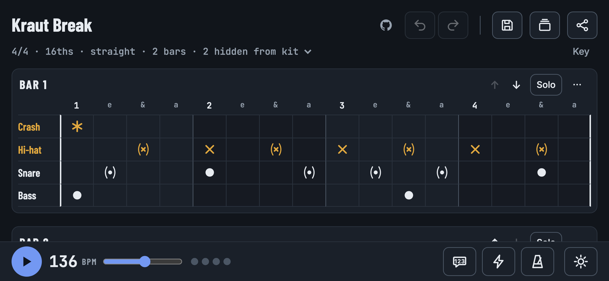

# Paradoodle

**Doodle your grooves.**

**Try it now: [dr-duplo.github.io/paradoodle](https://dr-duplo.github.io/paradoodle/)**. It runs in any modern browser and is made for phones.

A groove pops into your head on the bus, in the rehearsal room or halfway through a song you're listening to. Paradoodle is a place to get it down before it's gone. Tap the beat into a grid on your phone, play it back to check it feels right, and when it does, export a proper drum sheet with staff notation to bring to the next session.



The whole app is a single HTML file. There's nothing to install, no account and no server. Your loops stay in your browser.

## About the name

A _paradiddle_ is one of the first rudiments every drummer learns: right, left, right, right, left, right, left, left. A _doodle_ is what you scribble in the margin when an idea won't leave you alone. Paradoodle is the two put together: drum ideas, sketched quickly and a little messily, the way they arrive.

## What it does

**Sketch.** The grid has rows for crash, ride, hi-hat, snare, bass drum and hi-hat foot. Tap a cell to cycle through its sounds (closed, open or ghosted hi-hat; hit, rim or ghost on the snare) and hold it to clear. Bars can have 2 to 7 beats in 8ths, triplets or 16ths, with as much swing as the groove needs. A loop holds up to 8 bars, and you can name, reorder, duplicate or solo each one.

**Listen.** Playback uses a small drum kit synthesised in the browser. A metronome click, a flash on every beat or a spoken "1, 2, 3, 4" help you lock in, and the bar that's playing scrolls into view.

**Keep.** Save loops to your library, undo and redo as much as you like (⌘Z / Ctrl+Z, ⇧⌘Z / Ctrl+Y), and back everything up as a JSON file.

**Share.** Every loop fits into a link. Send it to your bandmate and they open exactly what you wrote, or paste one into the app to open it. When the app runs as its own page, the address follows along as you edit, so a bookmark or a copied address always holds the current groove.

**Print.** Export a drum sheet with staff notation, the grid, or both, as a PNG or an A4 PDF.

To get you started, the app opens with the **Kraut Break**, a two-bar groove full of ghost notes. You'll find it again under Loops → Examples.

## Run it

Open `index.html` in a browser. That's it.

The notation library (VexFlow) and the PDF library (jsPDF) load from public CDNs the first time you export, so exporting needs a connection. Sketching and playback work offline.

### GitHub Pages

`.github/workflows/pages.yml` builds the site and publishes it on every push to `main`. The live app is at [dr-duplo.github.io/paradoodle](https://dr-duplo.github.io/paradoodle/). For a fork, set **Settings → Pages → Source** to **GitHub Actions** once, and it is served at `https://<user>.github.io/<repo>/`.

## How the code is organized

There is no framework and no bundler during development. `index.html` holds the markup, `styles.css` the look, and `js/` the behaviour, split into plain scripts that load in order and share one global scope. Each file starts with a short note on what it does.

| File                 | What it does                                                                                     |
| -------------------- | ------------------------------------------------------------------------------------------------ |
| `js/basics.js`       | The drum kit, the note symbols and small helpers (`$`, `esc`, `store`)                           |
| `js/state.js`        | The loop being edited (`S`), checking and repairing loops, undo history, the unsaved-changes dot |
| `js/render.js`       | Draws the summary line, kit chips and every bar's grid                                           |
| `js/editing.js`      | Tapping cells and everything else you can change about a loop                                    |
| `js/audio.js`        | The synthesised drum kit and the spoken count                                                    |
| `js/playback.js`     | Play and stop, the scheduler, playhead, click and beat flash                                     |
| `js/notation.js`     | Staff notation with VexFlow                                                                      |
| `js/export-sheet.js` | The printable sheet as PNG or PDF                                                                |
| `js/examples.js`     | Built-in example grooves                                                                         |
| `js/library.js`      | Saved loops and the Loops panel                                                                  |
| `js/loop-files.js`   | Exporting and importing loops as JSON                                                            |
| `js/share-links.js`  | Packing a loop into a link and opening links                                                     |
| `js/tooltips.js`     | Hover tips on buttons                                                                            |
| `js/main.js`         | Starts the app                                                                                   |
| `js/count-sounds.js` | The spoken count as base64 WAV data                                                              |

## Development

You need Node 18 or newer.

```sh
npm install
npm run check   # formatting, lint and build in one go
```

- `npm run format` formats everything with Prettier, and `npm run format:check` only reports.
- `npm run lint` runs ESLint.
- `npm run build` writes `dist/index.html`: a single minified file with the styles and scripts inlined. That's what GitHub Pages serves.

Every pull request runs the same checks plus `npm audit` (`.github/workflows/ci.yml`). CodeQL scans the code for security problems, and Dependabot proposes dependency and workflow updates every week. To make the checks block merging, add a branch rule for `main` under **Settings → Rules** that requires the **CI / check** status.

## How share links work

A loop is packed bit by bit and written in base32 (`0-9a-v`) after `#paradoodle-`. A two-bar groove usually comes out at 50 to 120 characters. The `paradoodle-` tag marks the start of a loop, so the app finds one in any text: paste a link, or a whole chat message containing it, anywhere outside a text field and the loop opens.

| Field                        | Bits                                                                                   |
| ---------------------------- | -------------------------------------------------------------------------------------- |
| Format version               | 4                                                                                      |
| Beats per bar − 2            | 3                                                                                      |
| Feel (8ths, triplets, 16ths) | 2                                                                                      |
| Tempo − 40                   | 8                                                                                      |
| Swing − 50 %                 | 5                                                                                      |
| Hidden kit rows              | 6                                                                                      |
| Bars − 1                     | 3                                                                                      |
| Loop name                    | 8-bit length + UTF-8                                                                   |
| Per bar                      | default-name flag (or name), 6-bit mask of rows with notes, then each used row's steps |

Each step takes only the bits its row needs: 1 for bass drum, crash and hi-hat foot, 2 for ride, hi-hat and snare. Rows without notes cost nothing. Links in the older version 1 format, which stored every row, still open.

## Built with

- [VexFlow](https://www.vexflow.com/) for staff notation (MIT)
- [jsPDF](https://github.com/parallax/jsPDF) for PDF export (MIT)
- [Piper](https://github.com/OHF-Voice/piper1-gpl) with the `en_US-ljspeech-high` voice for the spoken count. The voice is trained on the public-domain [LJ Speech](https://keithito.com/LJ-Speech-Dataset/) dataset, and only the generated recordings ship with the app.
- [Barlow Condensed](https://fonts.google.com/specimen/Barlow+Condensed), [Inter](https://fonts.google.com/specimen/Inter) and [JetBrains Mono](https://fonts.google.com/specimen/JetBrains+Mono) from Google Fonts (SIL Open Font License)

## License

[MIT](LICENSE)
